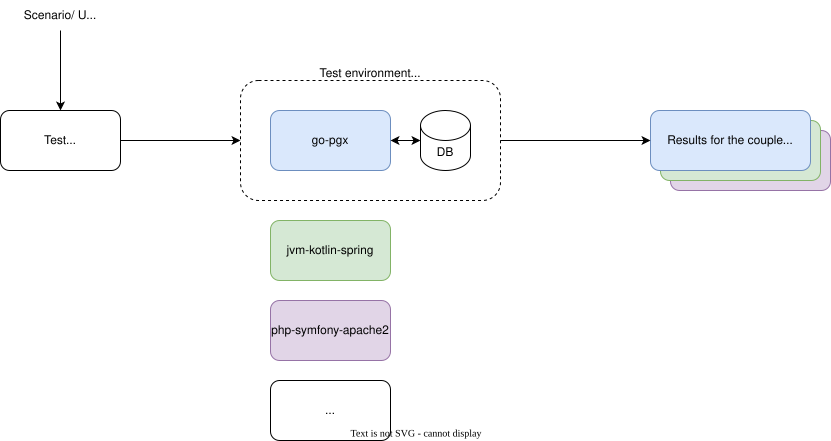

# Eco benchmark 4 builder e-footprint

## Goal

This project aim to provide data driven builder for [e-footprint project](https://github.com/Boavizta/e-footprint).

e-footprint builder are technical compounds of full user journey modelized within e-footprint python API. It will allow designers to setup language, framework or db in the e-foootprint user journey and see the environnemtal impacts (direct energy or indirect manufacturing impact by saturating existing servers).

The project is the next step of the original [eco-benchmark project](https://github.com/Boavizta/ecobenchmark-applicationweb-backend)

## How does it works?

### Running benchmarks: local VMs or dedicated Linux servers

The benchmark harness uses two Lima Linux VMs locally, or two existing Linux
servers over SSH (including OVH dedicated servers).
VM storage defaults to `/Volumes/Extension/ecobench-vms`. See
[benchmark/README.md](benchmark/README.md) for setup, commands, result formats, and
measurement limitations. VM runs measure resources/performance, not physical energy.

The same Compose stack and k6 scenarios run in both environments. See the
[SSH setup guide](benchmark/README.md#dedicated-linux-servers-over-ssh) for deployment.

This repository contains  different benchmarking scenario to try to compare the energy consumption and server saturation for several set of languages, frameworks and db.

The different scenario will be the following, for each set of languages, frameworks and db:

- default, optimised but not extremely.

The repository :
- **IS NOT** a language competition,
- so **DON'T** provide expert/ninja tuning Pull Request, except it's a well known practice.

## What data we should get from the benchmark ?

To fill a e-footprint builder, we need to gather this data by builder :

- job_type
- technologies
- data_upload
- data_download
- cpu_needed
- ram_needed
- request_duration

Data is input as a set of value and unit in the builder, so all data should go with a unit.

## e-footprint builder scope

This project is here to provide date for the following job types builders :

- DATA_READ
- DATA_WRITE
- DATA_LIST
- DATA_SIMPLE_ANALYTIC
- TRANSACTION
- NOTIFICATION

[See the job model](https://github.com/Boavizta/e-footprint/blob/main/efootprint/core/usage/job.py)

## evaluated technology scope

Available in folder [/service](/service)

Name are built like this :

language-framework[-framework][-framework][-framework]-db

Exemple : 
- node-express-sequelize-mysql
- python-fastapi-pg
- php-symfony-apache2-dev-pg

## Contributing

For agent-assisted work, start with [AGENTS.md](AGENTS.md); it routes to the project
scope, evidence rules, dated measurement snapshot, and e-footprint contract research.

Everybody is more than welcome to contribute to this benchmark! Please check out the [Contributing guide](CONTRIBUTING.md) for guidelines about how to proceed.

You can also [join us](https://boavizta.org/en/contact) and become a member of the non-profit French association.

## License

The eco-benchmark is released under the [AGPL-3.0 license](LICENSE).
