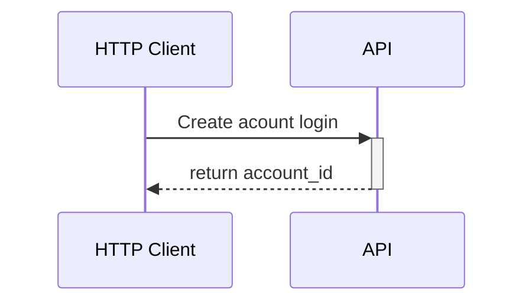
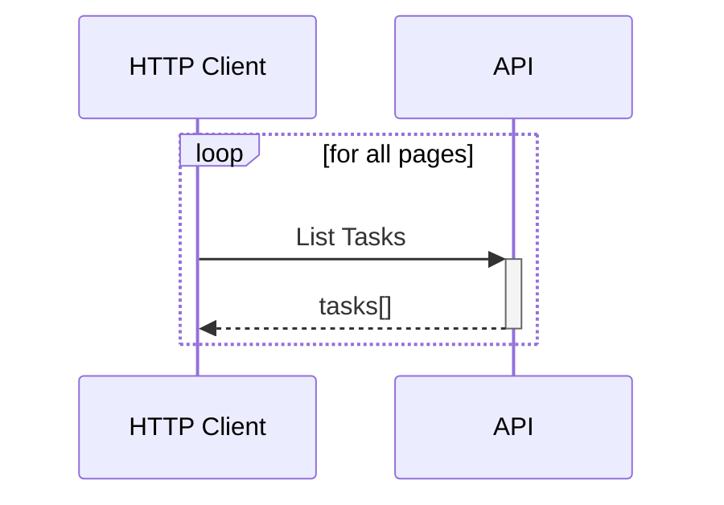
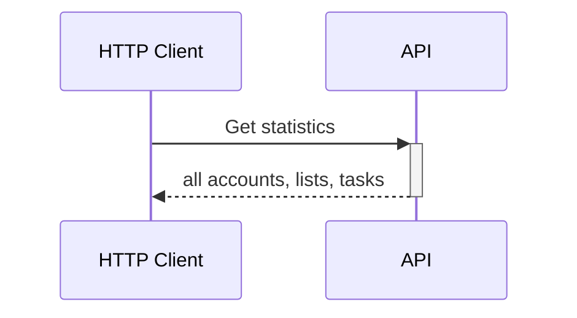

# Runner container

The supported benchmark workflow is documented in [benchmark/README.md](../benchmark/README.md).
This directory retains historical write and mixed-journey scenarios for future migration;
there is no separate runner image to build. Mount these scripts into a k6 container
when testing them manually.

The runner uses [k6](https://k6.io/) to test the service specified in `SERVER_HOST` env var and execute the following load testing scenarios:


# Scenariis

## In which order should I launch the test?

1. scenario-INIT.js
2. scenario-DATA_WRITE.js
3. all other scenario-xxx.js


## scenario-INIT.js

To launch before all scenario



Retrieve the account ID from the setup response, then pass it as the `ACCOUNT_ID`
environment variable to subsequent scenarios. The supported read benchmarks instead
use a deterministic SQL dataset and need no account-ID handoff.

## scenario-DATA_WRITE.js

```mermaid
sequenceDiagram
participant C as HTTP Client
    API-->>-C: list
    loop 20 times
        C->>+API: Create Task
        API-->>-C: task
    end
```

## scenario-DATA_LIST.js



## scenario-SIMPLE_ANALYTIC.js


